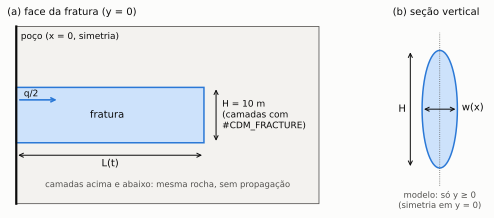
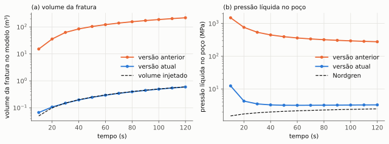
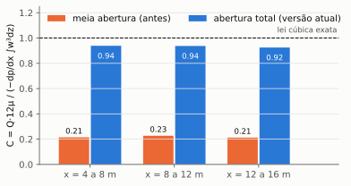
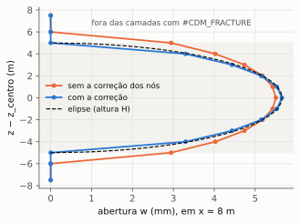
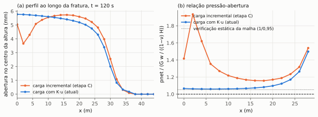
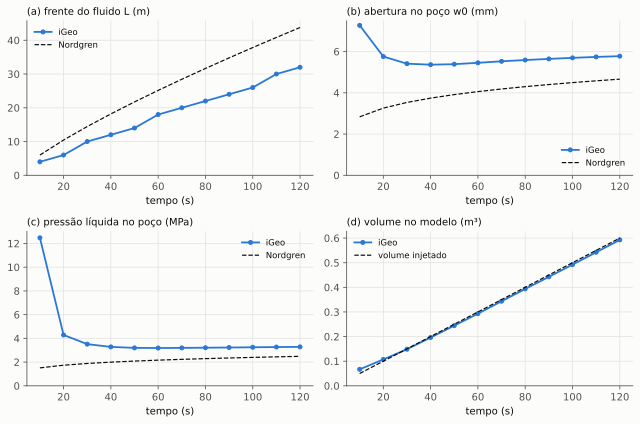
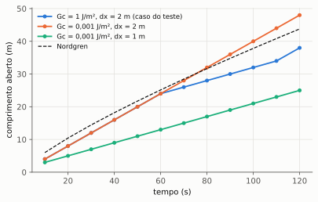

# Verificação do iGeo com o modelo PKN e correções no acoplamento da fratura

## Resumo

- **Caso usado:** fratura vertical de altura fixa (10 m), propagada por injeção a vazão constante de um fluido viscoso (100 cP), numa rocha elástica impermeável. A solução de referência é a de Nordgren (1972) para o modelo PKN, sem perda de fluido e sem tenacidade.
- **Ponto de partida:** a versão anterior do iGeo não conseguia simular o caso. Em 120 s, o volume da fratura ficou 365 vezes maior que o volume injetado, e a pressão líquida no poço chegou a 277 MPa (Nordgren: 2,5 MPa).
- **Quatro defeitos encontrados e corrigidos:**
  1. a equação de fluxo não tinha o aumento de volume da fratura: o fluido injetado não tinha para onde ir;
  2. a lei cúbica usava a meia abertura no lugar da abertura total, e a condutividade da fratura ficava 4 vezes menor;
  3. ao abrir um elemento, a propagação liberava os nós que ele compartilha com elementos intactos, e a fratura crescia uma camada acima e outra abaixo da zona permitida;
  4. a carga na face da fratura não liberava corretamente os nós da frente: o perfil de abertura de uma fratura em propagação ficava distorcido. A carga passou a usar a força interna nodal `K·u`.
- **Resultado:** o volume da fratura acompanha o injetado (−1,2 %), a seção vertical é elíptica e tem a rigidez de deformação plana (dentro de 6 %, que é o erro da malha), a vazão ao longo da fratura segue a lei cúbica (coeficiente 0,93) e a fratura fica contida na altura.
- **O que ainda não bate:** em 120 s, a frente do fluido está em 32 m (Nordgren: 43,8 m), a abertura no poço está 24 % acima e a pressão líquida 32 % acima. A diferença está no tratamento da ponta: com Gc pequeno, o critério de propagação abre um elemento por subpasso de acoplamento, qualquer que seja a física, e à frente do fluido fica uma zona seca com pressão negativa que o modelo PKN não tem.
- **Teste:** [`tests/test_pkn_injection.py`](../../tests/test_pkn_injection.py) verifica as partes que o iGeo deve reproduzir e registra a comparação com Nordgren como falha esperada. A versão anterior falha em 20 verificações.

---

## 1. O caso de referência

### 1.1 Solução de Nordgren

No modelo PKN (Perkins & Kern, 1961; Nordgren, 1972), a fratura tem altura *H* fixa e comprimento *L* muito maior que *H*. Cada seção vertical está em deformação plana e é elíptica, com abertura máxima proporcional à pressão líquida local:

$$
w(x,t) = \frac{(1-\nu)\,H}{G}\,p_{net}(x,t)
$$

O fluido escoa ao longo da fratura pela lei cúbica, e o volume da fratura é o volume injetado. Sem perda de fluido e sem tenacidade, a solução de Nordgren para uma asa com vazão *q* é:

$$
L(t) = 0{,}68\left[\frac{G\,q^3}{(1-\nu)\,\mu\,H^4}\right]^{1/5} t^{4/5},
\qquad
w_0(t) = 2{,}5\left[\frac{(1-\nu)\,\mu\,q^2}{G\,H}\right]^{1/5} t^{1/5}
$$

e a pressão líquida no poço é `pnet = G w0 / ((1−ν) H)`.

### 1.2 Modelo no iGeo

Arquivo: [`tests/pkn_injection/pkn_injection.geo`](../../tests/pkn_injection/pkn_injection.geo).



*Figura 1 — (a) Face da fratura (plano y = 0): a fratura ocupa a altura H das camadas com `#CDM_FRACTURE` e cresce a partir do poço. (b) Seção vertical elíptica. O iGeo modela 1/4 do domínio (x ≥ 0, y ≥ 0): metade de uma asa, com vazão q/2, e o deslocamento da face é a meia abertura.*

| Hipótese do PKN | Como foi representada no iGeo |
|---|---|
| Altura fixa | `#CDM_FRACTURE` só nas camadas 9 a 18 (10 camadas de 1 m); acima e abaixo, 8 camadas de espessura crescente (até 35,5 m de cada lado) |
| Rocha elástica homogênea | Mesmos E, ν e tensões em todas as camadas; `Kg = Kb`, então o coeficiente de Biot ≈ 0 |
| Sem perda de fluido | Permeabilidade de 10⁻⁵ mD |
| Sem tenacidade | Gc = 1 J/m² (K_IC ≈ 0,1 MPa·m^½, contra uma pressão líquida de ~2,5 MPa) |
| Pressão líquida inicial nula | Pressão de poros inicial igual a Shmin (10 MPa) |
| Fluido newtoniano, sem gravidade | 100 cP, densidade desprezível |
| Vazão constante | `#WELLRATECONSTRAINT`, 12 passos de 10 s, 432 m³/d no modelo (q = 0,01 m³/s por asa); injeção nos 9 nós internos do poço |
| Fratura inicial | Pré-fratura de 2 m (um elemento) em toda a altura, com abertura inicial de 0,1 mm só para a condutividade |

Parâmetros: E = 10 GPa (G = 4 GPa), ν = 0,25, H = 10 m. Malha: dx = 2 m (domínio de 120 m), 20 elementos em y (60 m, progressão geométrica) e 26 camadas em z; 31 200 elementos.

Resultado esperado (Nordgren) em t = 120 s: L = 43,8 m, w0 = 4,66 mm, pnet = 2,49 MPa e volume no modelo de 0,6 m³.

---

## 2. Ponto de partida: a versão anterior



*Figura 2 — Volume da fratura e pressão líquida no poço (escala logarítmica). Na versão anterior, o volume fica centenas de vezes acima do injetado, e a pressão fica na casa das centenas de MPa. A versão atual acompanha o volume injetado.*

Com a versão anterior, a pressão líquida no poço foi a 1 493 MPa no 1º passo e a 277 MPa no 12º, e a abertura no poço chegou a 315 mm. O volume da fratura no fim (219 m³) é 365 vezes o injetado (0,6 m³), e a fratura cresceu 8 m por passo, até 94 m.

---

## 3. As correções

As quatro correções são independentes e foram aplicadas em sequência. A tabela resume o efeito de cada uma, em t = 120 s:

| Versão | Volume / injetado | w0 (mm) | pnet no poço (MPa) | Frente do fluido (m) | Lei cúbica (C) | Abertura na borda da zona (mm) | Razão p/w em x = 8 m |
|---|---|---|---|---|---|---|---|
| Anterior | 365 | 315 | 277 | 88 | 0,002 | 320 | 0,99 |
| A: + balanço de massa | 0,984 | 5,90 | 3,67 | 24 | 0,22 | 3,5 | 0,96 |
| B: + lei cúbica | 0,978 | 4,70 | 2,92 | 30 | 0,86 | 2,9 | 0,95 |
| C: + liberação de nós | 0,984 | 5,05 | 3,81 | 32 | 0,99 | 0 | 1,27 |
| **D: + carga com K·u (atual)** | **0,988** | **5,78** | **3,28** | **32** | **0,93** | **0** | **1,06** |
| Nordgren | 1 | 4,66 | 2,49 | 43,8 | 1 | 0 | 1 |

O coeficiente C e a razão p/w estão definidos nas seções 3.2 e 3.4. Na etapa B, w0 e pnet ficam perto de Nordgren por acaso: a fratura tinha 12 m de altura em vez de 10 m (seção 3.3).

### 3.1 Balanço de massa da fratura

**Problema.** Em `FlowStepSolution` (`FluidFlowSolver.f90`), o armazenamento de cada nó tinha só a compressibilidade do fluido e dos poros:

```fortran
C(i) = -(V0*totalCompressibility + V1*Cw) / Bw(i)     ! V1 = volume da fratura no nó
```

O aumento de volume da fratura, `dV/dt`, não aparecia. A vazão injetada só podia ser absorvida pela compressão do fluido, e numa rocha impermeável a pressão divergia. A opção `#FRAC_UNBALVOLUME` tentava compensar isso, mas estava desligada por padrão e não conservava massa.

**Correção.** Como a mecânica é resolvida depois do fluxo, o volume da fratura em cada nó passou a ser escrito como

$$
V(p) = V_{mec} + C_f\,(p - p_{inicio})
$$

com `V_mec` = volume da última solução mecânica e `C_f` = complacência estimada de cada nó da face aberta. `C_f` entra no armazenamento, implícito na pressão. A diferença entre `V_mec` e o volume já contabilizado nas chamadas anteriores (`FracVolumeAccounted`) entra como fonte no primeiro subpasso aceito. Assim, o volume de fluido na fratura acompanha o da mecânica com um passo de atraso, e a massa é conservada:

```fortran
C(i) = -(V0*totalCompressibility + V1*Cw + fracCompliance(i)) / Bw(i)
...
RHS(i) = RHS(i) + fracMismatch(i) / (Bw(i) * dt)     ! fracMismatch = V_mec - V_contabilizado
```

`C_f` vem da solução de deformação plana, `u_max = (1−ν²) p Lc / E`, com `Lc` = mínimo entre a altura e duas vezes o comprimento da região aberta. O esquema é estável enquanto `C_f` for maior que metade da complacência real. O valor de `C_f` só muda a velocidade com que a diferença entre os volumes é corrigida, não o volume final.

**Efeito.** O volume da fratura passa a acompanhar o injetado (figura 2), e a pressão fica na escala de MPa.

### 3.2 Lei cúbica com a abertura total

**Problema.** O modelo representa só o lado y ≥ 0 da fratura. O deslocamento da face é a **meia** abertura, e o modelo conduz metade da vazão do canal. `UpdateHFtransmissibilityMatrix` usava a meia abertura como se fosse a total: a transmissibilidade saía proporcional a `uy³/12`, quando o correto é `(2uy)³/12 / 2 = uy³/3`. A condutividade ficava 4 vezes menor.

**Correção** (`HydraulicFractureModel.f90`):

```fortran
aperture = HFmodel%Aperture0(fracElement) + &
           2.0 * (HFmodel%Aperture(fracElement) - HFmodel%Aperture0(fracElement))   ! abertura total
PermTensor(1,1) = aperture**2.0 / 12
AX = 0.5 * aperture * LZ / 2.0          ! metade do canal em cada aresta do elemento
```

**Verificação local.** Entre dois passos, a vazão que atravessa uma seção x da fratura é a vazão injetada menos o aumento de volume entre o poço e x. Com ela, o gradiente de pressão e o perfil de abertura do iGeo, calcula-se o coeficiente

$$
C = \frac{Q\,12\,\mu}{-\frac{dp}{dx}\int w(z)^3\,dz}
$$

que deve ser 1 se a vazão segue a lei cúbica com a abertura total.



*Figura 3 — Coeficiente C em três trechos da fratura, no último passo. Com a meia abertura (etapa A), C ≈ 0,22, perto do 1/4 esperado. Na versão atual, C ≈ 0,93. Os 7 % que faltam vêm de a condutividade de cada elemento usar a média dos 4 nós, que subestima ∫w³dz.*

Essa verificação não depende da ponta da fratura, e entrou no teste automatizado.

### 3.3 Liberação de nós na propagação

**Problema.** Um nó da face só deve ser solto (deslocamento normal livre) quando todos os elementos da face que o contêm estão abertos. É o que `BuildHydraulicFractureModel` faz com a pré-fratura. Em `PropagateFracture_TractionDamage`, os contadores `nodeCounter` e `freeNodeCounter` só somavam os elementos abertos naquela chamada. Os dois eram sempre iguais, e os 4 nós de cada elemento recém-aberto eram soltos, inclusive os que ele compartilha com elementos intactos. Os nós da borda da zona eram soltos, os elementos de fora passavam a contar como abertos (`CheckFractureDisplacement` considera aberto todo elemento com algum nó solto), e a fratura crescia uma camada acima e outra abaixo da zona com `#CDM_FRACTURE`.

**Correção:** os contadores passaram a ser calculados sobre todos os elementos da face, com a mesma regra da construção do modelo.



*Figura 4 — Abertura ao longo da altura em x = 8 m, no fim da simulação. Sem a correção, os nós da borda da zona (z = ±5 m) abrem quase 3 mm, e a fratura tem 12 m de altura. Com a correção, a seção é a elipse de altura H.*

### 3.4 Carga na face com a força interna `K·u`

**Problema.** A carga na face da fratura vinha da tensão média do elemento vizinho (`p + σyy`). No relatório do Sneddon, isso foi trocado por uma carga incremental: `p + σyy` na primeira carga de cada elemento e depois só `Δp`. Numa fratura em propagação, a parte da carga que caía nos nós restritos da frente ia para as reações, e não era liberada quando esses nós se soltavam. O resultado (etapa C) foi um perfil com uma "corcova" no meio, mais aberto longe do poço que junto dele, e uma seção 27 % mais rígida que a de deformação plana.

**Por que não usar as tensões.** A forma consistente de liberar um nó é aplicar a reação que ele transmitia. A primeira tentativa calculou essa reação com as tensões dos elementos (integral de `B^T σ`). O resíduo não se anulava nos nós perto da ponta, mesmo com o solver linear convergido. A investigação mostrou que o iGeo calcula as tensões num único ponto por elemento (`NumIntegrationPoints = 1` em `DiscretizedModel.f90`), mas monta a matriz de rigidez com 8 pontos. A força interna calculada pelas tensões não reproduz `K·u`, porque os modos de ampulheta não aparecem no ponto central, e a diferença se concentra onde há gradiente, perto da ponta.

**Correção** (`UpdateHydraulicFracture` e `RunFracWaterInjection`). Em cada nó livre da face, a carga é

$$
R = F_{fluido} - \left(F_{inicial} + (K\,u)_y\right) + F_{outras}
$$

- `F_fluido`: p·área/4 de cada elemento aberto que contém o nó;
- `K·u`: produto da matriz de rigidez do solver pelo deslocamento atual;
- `F_inicial`: força interna das tensões iniciais, calculada uma vez depois de construir o modelo da fratura (tensões efetivas, menos `K·u` naquele instante, menos a carga poroelástica da pressão de poros inicial);
- `F_outras`: soma das outras cargas externas (poroelástica, térmica) já aplicadas no nó.

Num nó livre em equilíbrio, `F_inicial + K·u` é exatamente a carga já aplicada, e `R` é só a variação da pressão: não há deriva. Num nó recém-liberado, `R` é exatamente a força de liberação mais a pressão do fluido.



*Figura 5 — (a) Abertura no centro da altura em t = 120 s. Com a carga incremental (etapa C), o perfil tem uma corcova em x ≈ 15 m. Com a carga `K·u`, a abertura diminui do poço para a ponta, como no PKN. (b) Razão entre a pressão líquida e a pressão de deformação plana para a abertura local. Com `K·u`, ela fica em 1,06 ao longo da fratura, igual à rigidez da malha medida na verificação estática (seção 4.2).*

No caso de Sneddon, a carga `K·u` dá os mesmos números da carga incremental a partir do 2º passo, e também não deriva com a pressão mantida.

---

## 4. Resultado comparado com Nordgren

### 4.1 Evolução no tempo



*Figura 6 — Versão atual comparada com Nordgren: (a) frente do fluido (primeiro nó com pressão líquida abaixo de 5 % da do poço), (b) abertura no poço, (c) pressão líquida no poço e (d) volume da fratura no modelo.*

- **Volume:** acompanha o injetado em todo o tempo (−1,2 % em 120 s). O balanço de massa está correto.
- **Frente do fluido:** cresce de forma aproximadamente linear e fica atrás da solução: 32 m em 120 s, contra 43,8 m (−27 %).
- **Abertura e pressão no poço:** depois do rompimento da pré-fratura (pico de 12,5 MPa no 1º passo), ficam quase constantes, em 5,8 mm e 3,3 MPa. Nordgren dá 4,7 mm e 2,5 MPa, que crescem com t^(1/5). Como o volume está certo e a fratura está mais curta, ela fica mais larga e com mais pressão.

### 4.2 Verificação estática da seção

Para separar o erro elástico da malha, foi rodada uma fratura pré-existente de 40 m, com pressão uniforme de 1 MPa e sem propagação. A abertura no meio do comprimento, dividida pela de deformação plana `w = 2(1−ν²) Δp H / E`, foi:

| Malha na altura | x = 0 | x = 10 m | x = 20 m | x = 30 m |
|---|---|---|---|---|
| dz = 1 m (10 elementos, como no caso) | 0,951 | 0,953 | 0,950 | 0,914 |
| dz = 0,5 m (20 elementos) | 0,962 | 0,964 | 0,961 | 0,924 |

Com 10 elementos na altura, a seção é cerca de 5 % mais rígida que a teórica, e o erro diminui com o refino. Em x = 30 m, a 10 m da ponta, já aparece o efeito tridimensional do fim da fratura. A razão p/w de 1,06 da versão atual (figura 5b) corresponde a esse erro de malha. Com a carga incremental, a razão chegava a 1,27 no meio da fratura e a 1,9 perto do poço.

---

## 5. O que ainda não bate: a ponta da fratura

### 5.1 O critério de propagação avança um elemento por subpasso



*Figura 7 — Comprimento aberto (fim da região com abertura) ao longo do tempo. Com Gc = 0,001 J/m², o comprimento cresce exatamente um elemento por subpasso de acoplamento (2 subpassos de 5 s por passo): 4 m por passo com dx = 2 m e 2 m por passo com dx = 1 m. Com Gc = 1 J/m², ele cresce um pouco mais devagar.*

`PropagateFracture_TractionDamage` abre o elemento à frente quando uma estimativa da integral J passa de Gc. A estimativa soma `σyy·εyy·DJ` dos elementos à frente da ponta, só onde σyy é de tração. Com Gc pequeno, qualquer tração à frente de uma fratura pressurizada basta. O elemento recém-aberto só recebe carga no subpasso seguinte, então a frente avança exatamente um elemento por subpasso. A velocidade da frente vira `dx / Δt`, uma grandeza numérica. Com Gc maior, o critério passa a funcionar como uma tenacidade, estimada de forma grosseira e dependente da malha. Nos dois casos, o comprimento aberto não é controlado pela física do PKN.

### 5.2 A zona seca à frente do fluido

No PKN, a ponta da fratura é a frente do fluido. No iGeo, entre a frente do fluido e o fim da região aberta fica uma zona seca: elementos abertos pelo critério, ainda sem fluido. O balanço de massa puxa fluido para esses elementos, a pressão lá fica abaixo de Shmin (pressão líquida de −0,1 a −0,5 MPa), e essa sucção fecha a zona seca. Além disso, a condutividade do elemento da frente usa a média dos 4 nós, dois deles secos, e fica cerca de 8 vezes menor. A frente do fluido avança mais devagar que na solução de Nordgren.

Dois testes indicam que a diferença vem dessa região, e não do critério de propagação em si:

- **Fratura pré-cortada:** com uma pré-fratura de 70 m (maior que o comprimento final) e sem `#CDM_FRACTURE`, a frente é definida só pelo fluido. O resultado é praticamente o mesmo do caso com propagação: w0 = 5,90 mm e pnet = 3,35 MPa em 120 s (contra 5,78 mm e 3,28 MPa).
- **Refino em x:** com dx = 1 m, a frente do fluido fica presa ao avanço de um elemento por subpasso (24 m em 120 s), e a abertura e a pressão se afastam ainda mais de Nordgren.

Reproduzir a ponta do PKN exige tratar a frente do fluido dentro do elemento da ponta, por exemplo com a fração preenchida do elemento ou com a assíntota de ponta, como nos simuladores do benchmark de Lecampion et al. (2013). Isso ficou fora deste trabalho.

---

## 6. Teste automatizado

[`tests/test_pkn_injection.py`](../../tests/test_pkn_injection.py) roda o caso uma vez (cerca de 30 s) e verifica:

| Verificação | Critério | Valor obtido |
|---|---|---|
| Volume da fratura (passos 4 a 12) | ±3 % do volume injetado | −1,2 % a −2,3 % |
| Contenção da altura | `uy = 0` fora da zona e na sua borda (z = ±H/2) | 0 |
| Seção vertical (x = 4, 8 e 12 m) | erro L2 em relação à elipse < 3 % | 1,3 % |
| Rigidez da seção (x = 4, 8 e 12 m) | pnet / (G w / ((1−ν) H)) entre 1,00 e 1,12 | 1,06 |
| Lei cúbica local (três trechos) | C entre 0,85 e 1,05 | 0,92 a 0,94 |
| Perfil ao longo da fratura | a abertura não cresce mais de 1 % entre nós até a frente do fluido | diminui sempre |
| Comparação com Nordgren (falha esperada) | L, w0 e pnet a ±10 % | −27 %, +24 %, +32 % |

A comparação com Nordgren está marcada como `expectedFailure`. Quando a ponta for corrigida, ela passa a ser reportada como sucesso inesperado, sinal para apertar o teste.

Cada etapa da correção falha em testes diferentes, o que mostra que cada verificação detecta um defeito real:

| Versão | Falhas | Verificações que falham |
|---|---|---|
| Anterior | 20 | volume, contenção, elipse, rigidez, lei cúbica, perfil |
| A: + balanço de massa | 12 | contenção, elipse, rigidez, lei cúbica, perfil, volume nos passos 4 e 5 |
| B: + lei cúbica | 11 | contenção, elipse, rigidez, perfil, lei cúbica em um trecho, volume em dois passos |
| C: + liberação de nós | 7 | rigidez, perfil, volume nos passos 4 a 6 |
| D: + carga com K·u (atual) | 0 | — |

```bash
ctest --test-dir build -L pkn --output-on-failure
```

---

## 7. Efeito em outros casos e próximos passos

- **Sneddon:** os testes continuam passando, com os mesmos números a partir do 2º passo. No fim do 1º passo, a fratura ainda está terminando de encher pelo fluxo, e a pressão perto da ponta está 0,5 % abaixo da do poço. A tolerância do teste de uniformidade da pressão passou de 0,5 % para 1 % ([`docs/relatorio_sneddon/`](../relatorio_sneddon/README.md)).
- **M3_injection_test:** com a versão atual, a pressão é praticamente a mesma da versão original, e a fratura não se propaga em 150 min de tempo simulado. A primeira versão da correção do Sneddon dava 43 avanços em 22 min. A propagação nesse caso é muito sensível ao carregamento da face e ao critério J.
- **Casos com rocha permeável:** o balanço de massa da fratura vale para todos os casos. Agora o fluido que abre a fratura deixa de ir para a rocha, o que muda os resultados dos casos de `Simulation_cases/`.

Próximos passos:

1. **Ponta da fratura:** tratar a frente do fluido dentro do elemento da ponta e trocar o critério J por um critério que convirja com a malha. Validar contra o PKN (este caso) e o KGD, nos regimes de viscosidade e de tenacidade (Detournay, 2004; Lecampion et al., 2013).
2. **Tensões em 8 pontos:** com `NumIntegrationPoints = 8`, a força interna das tensões passaria a ser consistente com a rigidez. Isso exige revisar os trechos que leem o ponto 1 como se fosse o centro do elemento (integral J, Cam-Clay, saídas).
3. **Comparar com os resultados do autor:** rodar os casos de `Simulation_cases/` com e sem as correções no build Intel original.

---

## 8. Como gerar o PDF e reproduzir as figuras

O [`Makefile`](Makefile) desta pasta (com as regras comuns de [`docs/relatorio.mk`](../relatorio.mk)) gera o PDF com pandoc e xelatex:

```bash
make -C docs/relatorio_pkn        # gera docs/relatorio_pkn/build/relatorio_pkn.pdf
```

As figuras são geradas por [`gerar_figuras.py`](gerar_figuras.py) a partir de simulações do caso do teste, com os executáveis de cada etapa da correção. A docstring do script descreve a pasta esperada. A etapa "anterior" usa o commit `7cc39f5`; as etapas A, B e C foram compiladas aplicando as correções em sequência sobre esse commit. Elas são trechos independentes de `FluidFlowSolver.f90` (A) e de `HydraulicFractureModel.f90` (B: `UpdateHFtransmissibilityMatrix`; C: `PropagateFracture_TractionDamage`).

```bash
make -C docs/relatorio_pkn figuras DADOS=<pasta>
```

---

## Referências

- T. K. Perkins, L. R. Kern (1961). Widths of hydraulic fractures. *J. Pet. Tech.* 13(9), 937–949.
- R. P. Nordgren (1972). Propagation of a vertical hydraulic fracture. *SPE Journal* 12(4), 306–314.
- E. Detournay (2004). Propagation regimes of fluid-driven fractures in impermeable rocks. *Int. J. Geomech.* 4(1), 35–45.
- B. Lecampion et al. (2013). The impact of the near-tip logic on the accuracy and convergence rate of hydraulic fracture simulators compared to reference solutions. Em *Effective and Sustainable Hydraulic Fracturing*, InTech. [PDF](https://personal.math.ubc.ca/~peirce/Lecampion_et_al_BenchmarkPaper_2013.pdf)
