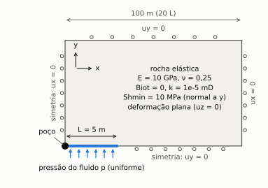
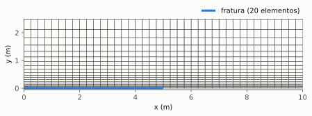
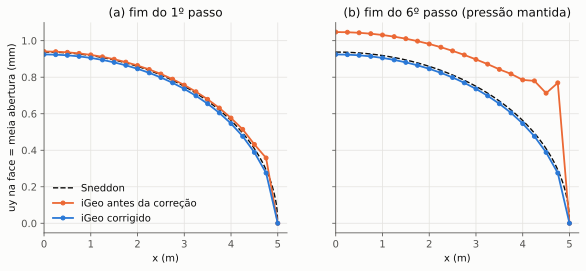
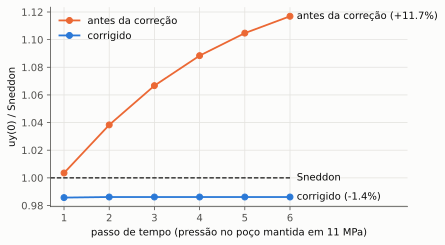
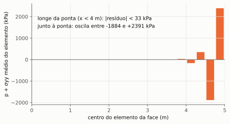
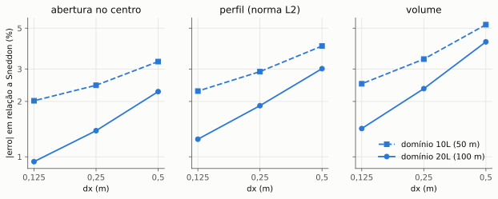
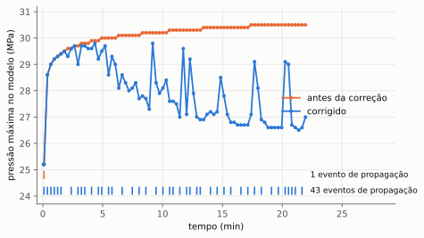

# Verificação do iGeo com a solução de Sneddon e correção do carregamento da fratura

## Resumo

- **Caso usado:** injeção, a pressão controlada, numa fratura de comprimento fixo, em deformação plana, numa rocha elástica impermeável. A solução analítica é a de Sneddon (1946) para uma fratura pressurizada.
- **Problema encontrado:** no primeiro passo de tempo o iGeo reproduzia a solução. A partir do segundo passo, a abertura crescia continuamente **mesmo com a pressão constante**: +11,7 % na abertura no centro e +22 % no volume depois de 6 passos.
- **Causa:** a cada passo, `UpdateHydraulicFracture` reaplicava como carga na face o resíduo `p + σyy`, com σyy igual à tensão **média** do elemento junto à face. No elemento da ponta a tensão é singular, essa média nunca chega a −p e o resíduo nunca zera.
- **Correção:** a carga de cada nó livre da face passa a ser o resíduo entre a força da pressão do fluido e a **força interna nodal**, calculada como `F_inicial + K·u` com a mesma matriz de rigidez do solver. Em equilíbrio esse resíduo é exatamente a variação da pressão, e num nó recém-liberado é exatamente a força de liberação.
- **Resultado:** a abertura fica constante enquanto a pressão é mantida. O erro em relação a Sneddon é de −1,4 % no centro e −2,4 % no volume, e diminui com o refino da malha e com o tamanho do domínio.
- **Efeito em fraturas que se propagam:** no caso `M3_injection_test`, o número de avanços da fratura mudou a cada versão do carregamento (1 evento na versão original, 43 em 22 min com a primeira versão desta correção, nenhum em 150 min com a versão atual). A propagação é muito sensível ao carregamento da face e ainda precisa ser validada.

> **Histórico.** A primeira versão desta correção aplicava a carga de forma incremental (`p + σyy` na primeira carga e depois só `Δp`). Ela resolvia o caso de Sneddon, mas na verificação PKN ([`docs/relatorio_pkn/`](../relatorio_pkn/README.md)) distorcia o perfil de fraturas em propagação. A seção 3 descreve a versão atual. A partir do 2º passo, as duas versões dão os mesmos números; no 1º passo a diferença é de 0,04 ponto percentual, porque agora a fratura precisa ser enchida pelo fluxo.

---

## 1. O caso de referência

### 1.1 Solução de Sneddon

Uma fratura de meio comprimento *L*, num meio elástico infinito em deformação plana, sob pressão líquida uniforme Δp, tem abertura total elíptica (Sneddon, 1946; Sneddon & Lowengrub, 1969):

$$
w(x) = \frac{4\,(1-\nu^2)\,\Delta p}{E}\,\sqrt{L^2 - x^2}
$$

O iGeo modela 1/4 do domínio (x ≥ 0, y ≥ 0), com simetria em x = 0 e em y = 0. A grandeza que ele calcula é o deslocamento da face, igual à **meia abertura** `uy = w/2`. O volume de fluido na fratura, no quarto de modelo com altura *H*, é:

$$
V = H\int_0^L u_y\,dx = \frac{\pi\,(1-\nu^2)\,\Delta p\,L^2 H}{2E}
$$

### 1.2 Modelo no iGeo

Arquivo: [`tests/sneddon_injection/sneddon_injection.geo`](../../tests/sneddon_injection/sneddon_injection.geo).



*Figura 1 — Quarto de modelo (desenho fora de escala). A fratura ocupa a face y = 0 entre o poço (x = 0) e x = L, e recebe a pressão do fluido. O resto da face y = 0 e os contornos têm deslocamento normal restrito.*

| Hipótese da solução | Como foi representada no iGeo |
|---|---|
| Deformação plana | Uma única camada (NZ = 1); o modelo BOX restringe `uz` no topo e na base |
| Rocha elástica | `Kg` igual ao módulo volumétrico drenado (`Kb = E/(3(1−2ν))`), então o coeficiente de Biot ≈ 0 |
| Sem perda de fluido para a rocha | Permeabilidade de 10⁻⁵ mD |
| Pressão líquida uniforme e conhecida | Pressão imposta no poço (`#WELLPRESSURECONSTRAINT`) e abertura inicial de 1 mm, que só entra na condutividade da fratura |
| Fratura fixa | Sem `#CDM_FRACTURE`, portanto sem propagação |
| Pressão líquida inicial nula | Pressão de poros inicial igual a Shmin (10 MPa) |
| Meio infinito | Domínio de 100 m × 100 m (20 L) |

Parâmetros: E = 10 GPa, ν = 0,25, L = 5 m, H = 1 m, pressão no poço de 11 MPa (Δp = 1 MPa). Resultado esperado: `uy(0) = 2(1−ν²)ΔpL/E = 0,9375 mm` e `V = 3,68×10⁻³ m³`.



*Figura 2 — Malha em planta junto à fratura: 400 × 45 elementos, dx = 0,25 m (20 elementos na fratura), com Y em progressão geométrica (o primeiro elemento tem cerca de 1 cm).*

**Por que pressão controlada, e não vazão.** Com a pressão imposta no poço, a pressão na fratura é conhecida e a abertura pode ser comparada diretamente com Sneddon. Quando este caso foi montado, a injeção a vazão controlada em rocha impermeável também divergia (a pressão chegou a 423 MPa), porque a equação de fluxo não incluía o aumento de volume da fratura. Isso foi corrigido na verificação PKN ([`docs/relatorio_pkn/`](../relatorio_pkn/README.md)). Desde essa correção, o fluido que abre a fratura vem do poço pela própria fratura, e no fim do 1º passo a pressão perto da ponta ainda está cerca de 0,5 % abaixo da do poço.

---

## 2. O problema: a abertura derivava com a pressão constante

O caso foi rodado com a pressão no poço mantida em 11 MPa por 6 passos. A solução física não muda nesse intervalo.



*Figura 3 — Meia abertura ao longo da fratura. (a) No fim do 1º passo, as duas versões estão próximas de Sneddon. (b) No fim do 6º passo, a versão anterior abriu bem acima da solução, e o excesso cresce em direção à ponta. A versão corrigida não muda.*



*Figura 4 — Abertura no centro dividida pela de Sneddon, passo a passo, com a pressão constante.*

| Passo | 1 | 2 | 3 | 4 | 5 | 6 |
|---|---|---|---|---|---|---|
| Antes da correção: erro no centro | +0,35 % | +3,8 % | +6,7 % | +8,8 % | +10,5 % | +11,7 % |
| Corrigido: erro no centro | −1,43 % | −1,39 % | −1,39 % | −1,39 % | −1,39 % | −1,39 % |

No 6º passo, o volume da fratura estava 22 % acima de Sneddon na versão anterior e 2,4 % abaixo na corrigida. No 1º passo da versão corrigida a fratura ainda termina de encher (pressão líquida média de 996,5 kPa), daí os −1,43 %.

A versão anterior parece melhor no 1º passo (+0,35 %) por acaso. Cada passo tem dois subpassos de acoplamento, e o segundo já soma um pouco da deriva, que compensa a rigidez do domínio finito. Essa compensação deixa de valer a partir do 2º passo.

### 2.1 Causa

Trecho original de `UpdateHydraulicFracture` (`HydraulicFractureModel.f90`), executado a cada subpasso de acoplamento para cada elemento aberto da fratura:

```fortran
sn = <σyy médio nos pontos de integração do elemento> - Biot * p_poros   ! tensão normal total
...
fy = (p + sn) * area * HFmodel%Damage(i)        ! resíduo aplicado como carga na face
IF ( .NOT.HFmodel%FracClosure .AND. fy<0.0 ) fy = 0.0
```

A carga aplicada na face é o **resíduo** entre a pressão do fluido `p` e a tensão normal `sn` do elemento vizinho à face (negativa em compressão). Esse esquema só converge se `sn` tender a −p em todos os elementos da fratura:

- **No primeiro carregamento**, a tensão é a inicial e uniforme (−Shmin), e o resíduo `(p − Shmin)·área` é exatamente a carga de Sneddon.
- **No interior da fratura**, depois de carregado, o elemento fica com σyy ≈ −p, e o resíduo some.
- **Junto à ponta**, a tensão real é singular (cresce como 1/√r). A tensão média de um elemento finito ali não chega a −p, e o resíduo nunca zera. A cada subpasso ele é reaplicado e soma carga nova, então a fratura abre um pouco mais a cada passo.



*Figura 5 — Resíduo `p + σyy médio` em cada elemento da face, no fim do 1º passo (versão anterior). Longe da ponta ele fica abaixo de 33 kPa. Nos três últimos elementos oscila entre −1,9 e +2,4 MPa, e é essa carga espúria que alimenta a deriva.*

---

## 3. A correção

Em `UpdateHydraulicFracture` (`HydraulicFractureModel.f90`), a carga deixou de ser calculada por elemento. Ela agora é aplicada em cada **nó livre da face** (um nó cujos elementos da face estão todos abertos):

```fortran
!F_fluido: p * área / 4 de cada elemento aberto que contém o nó
residual = targetForce(i) - (HFmodel%NodeInitialForce(i) + Ku(dof)) + HFmodel%NodeOtherLoad(i)
IF ( .NOT.HFmodel%FracClosure .AND. residual<0.0 ) residual = 0.0
Load(dof) = Load(dof) + residual
```

com `Ku = K·u`, o produto da matriz de rigidez do solver mecânico pelo deslocamento atual. Os outros termos:

- `NodeInitialForce`: força interna das tensões iniciais em cada nó da face, calculada uma vez em `RunFracWaterInjection`. É a força das tensões efetivas, menos `K·u` naquele instante, menos a carga poroelástica da pressão de poros inicial.
- `NodeOtherLoad`: soma das outras cargas externas (poroelástica, térmica) já aplicadas no nó.

Por que funciona:

- **Nó livre em equilíbrio:** a força interna é exatamente a carga já aplicada, e o resíduo é só `Δp·área`. Não há deriva, e a singularidade da ponta não entra na carga.
- **Nó recém-liberado** (pré-fratura no início, ou propagação): o resíduo inclui exatamente a reação que o nó transmitia. É a força de liberação mais a pressão do fluido. Para a pré-fratura sob tensão uniforme, dá `(p − Shmin)·área`, a mesma carga de antes.
- **Contato:** se um nó é travado numa re-solução porque o deslocamento ficou negativo, a carga dele vai para a reação, e o resíduo do subpasso seguinte a recupera.
- **Por que `K·u` e não as tensões:** o iGeo calcula as tensões num único ponto por elemento (`NumIntegrationPoints = 1`), mas monta a matriz de rigidez com 8 pontos. A força interna calculada pelas tensões não equilibra `K·u` nos nós perto da ponta (os modos de ampulheta não aparecem no ponto central), e o resíduo não se anularia.

A primeira versão desta correção (commit `b6affc8`) aplicava `p + σyy` só na primeira carga de cada elemento e depois só `Δp`. Ela não derivava, mas a parte da carga que caía nos nós restritos da frente ia para as reações e não era liberada quando eles se soltavam. Numa fratura em propagação, isso distorcia o perfil de abertura (veja a seção 5 do relatório PKN).

---

## 4. Resultados com a correção

### 4.1 Convergência

O erro em relação a Sneddon tem duas origens: a discretização (elementos lineares, que não representam a raiz quadrada da ponta) e o contorno fixo a distância finita, que deixa o modelo um pouco mais rígido que o meio infinito. As duas fazem o modelo abrir menos que a solução, e as duas diminuem com o refino da malha e com o aumento do domínio:



*Figura 6 — Erro relativo (em valor absoluto) em função de dx, para domínios de 10 L e 20 L (versão corrigida, 1º passo). Todos os erros têm sinal negativo.*

| Domínio | dx (m) | Abertura no centro | Perfil (L2) | Volume |
|---|---|---|---|---|
| 10 L (50 m) | 0,5 | −3,33 % | 4,05 % | −5,27 % |
| 10 L (50 m) | 0,25 | −2,49 % | 2,95 % | −3,45 % |
| 10 L (50 m) | 0,125 | −2,06 % | 2,33 % | −2,55 % |
| 20 L (100 m) | 0,5 | −2,30 % | 3,06 % | −4,26 % |
| **20 L (100 m)** | **0,25** | **−1,43 %** | **1,95 %** | **−2,40 %** |
| 20 L (100 m) | 0,125 | −0,98 % | 1,30 % | −1,48 % |
| 40 L (200 m) | 0,25 | −1,16 % | 1,70 % | −2,13 % |

A linha em negrito é a configuração do teste automatizado.

### 4.2 Teste automatizado

[`tests/test_sneddon_injection.py`](../../tests/test_sneddon_injection.py) roda o iGeo e verifica:

| Verificação | Critério | Valor obtido |
|---|---|---|
| Pressão na fratura | uniforme e igual à do poço (±1 %) | variação de 5,1 kPa (0,5 %); média 996,5 kPa |
| Abertura no centro | ±2 % de Sneddon | −1,43 % |
| Perfil da abertura | erro L2 < 3 % | 1,95 % |
| Volume da fratura | ±3 % de Sneddon | −2,40 % |
| Face fora da fratura | `uy = 0` | 0 |
| Convergência | o erro diminui de dx = 0,5 m para 0,25 m | sim, nas três métricas |
| Pressão mantida por 3 passos | variação de `uy(0)` < 0,1 % | idêntico em todos os dígitos gravados |

```bash
ctest --test-dir build -L sneddon --output-on-failure   # ou: make -C iGeo_vrs2.0 test
```

A versão anterior falha no teste de pressão mantida. Com o módulo de Young 10 % errado no `.geo`, falham os testes de abertura, perfil e volume, o que confirma que os critérios detectam erros reais.

---

## 5. Efeito em fraturas que se propagam

As correções também mudam simulações em que a fratura cresce. O caso [`Simulation_cases/M3_injection_test.geo`](../../Simulation_cases/M3_injection_test.geo) foi rodado com a versão original e com a versão atual. É uma pré-fratura com critério de propagação por dano (`#CDM_FRACTURE`, Gc = 455 J/m²), geomecânica e injeção a vazão crescente, numa malha de 60 mil elementos. O caso simula 360 min. A versão original foi interrompida em 35 min de tempo simulado; a atual, em 150 min.



*Figura 7 — Pressão máxima no modelo até 35 min de tempo simulado. Os traços na base marcam os subpassos em que a fratura avançou.*

- **Versão original:** a pressão sobe de forma suave até 30,5 MPa em 20 min, e a fratura avança uma única vez, no início.
- **Versão atual:** a curva de pressão praticamente coincide com a da original (30,5 MPa em 20 min), e a fratura não avança em 150 min de tempo simulado.
- **Primeira versão desta correção** (carga incremental, commit `b6affc8`): a fratura avançava 43 vezes em 22 min, e a pressão caía em dente de serra até 27,0 MPa em 20 min.

O número de avanços mudou a cada versão do carregamento da face. A integral J que decide a propagação usa a tensão e a deformação no centro do elemento da ponta, e responde fortemente a como a carga chega nos nós da frente. Sem uma solução de referência para este caso, não dá para dizer qual comportamento está correto. A verificação PKN ([`docs/relatorio_pkn/`](../relatorio_pkn/README.md)) mostra que o critério atual não reproduz uma propagação com tenacidade desprezível.

---

## 6. Outra correção feita no caminho

`ViscoplasticExplicitySolver.f90`: o vetor do pré-condicionador (`diag_precon`) recebia o valor 0 antes de ser alocado, o que é comportamento indefinido no Fortran. Com o compilador Intel isso não fazia nada; com o gfortran causava falha de segmentação no segundo passo estrutural de qualquer caso com fratura. A linha foi removida, porque a rotina seguinte (`CGpreConditioner`) aloca e preenche o vetor.

---

## 7. Limitações e próximos passos

1. **Validar a propagação.** Reproduzir uma fratura KGD (deformação plana, vazão constante, regime de tenacidade ou de viscosidade) e comparar com as soluções de referência (Detournay, 2004; benchmark de Lecampion et al., 2013). O critério de propagação também usa grandezas médias do elemento da ponta (integral J calculada com σyy e εyy do elemento), e pode ter a mesma sensibilidade à malha que foi corrigida aqui.
2. **Vazão controlada em rocha impermeável.** Resolvido na verificação PKN: o aumento de volume da fratura entrou no balanço de massa do fluxo ([`docs/relatorio_pkn/`](../relatorio_pkn/README.md)).
3. **Comparar com os resultados do autor.** Rodar os casos de `Simulation_cases/` com e sem a correção no build Intel original e comparar com os resultados publicados.

---

## 8. Como gerar o PDF e reproduzir as figuras

### 8.1 PDF do relatório

O [`Makefile`](Makefile) desta pasta (com as regras comuns de [`docs/relatorio.mk`](../relatorio.mk)) converte este README em PDF com pandoc e xelatex (MacTeX ou TeX Live):

```bash
# gera docs/relatorio_sneddon/build/relatorio_sneddon.pdf
make -C docs/relatorio_sneddon
```

No PDF, as figuras entram pelas versões `.pdf` de `figuras/`, versionadas junto com as `.svg`, e o filtro [`docs/pdf/figuras_pdf.lua`](../pdf/figuras_pdf.lua), comum aos relatórios, junta cada imagem com a sua legenda. As fontes padrão (Palatino e Menlo) são do macOS. Em outro sistema, indique fontes instaladas que tenham os símbolos gregos, por exemplo, no Linux, `make FONTE="DejaVu Serif" FONTE_MONO="DejaVu Sans Mono"`.

### 8.2 Figuras

As figuras são geradas por [`gerar_figuras.py`](gerar_figuras.py) a partir de simulações feitas com o executável atual (`iGeo_vrs2.0/build/iGeo`) e com um executável compilado a partir da versão anterior de `HydraulicFractureModel.f90` (commit `b8828cb`, pastas `rel/antigo` e `prop/antigo`). A docstring do script descreve a estrutura esperada da pasta com as simulações (`<pasta>`):

- o caso do teste com 6 passos de pressão mantida;
- as variantes de malha e de domínio do estudo de convergência;
- o caso `M3_injection_test`.

```bash
make -C docs/relatorio_sneddon figuras DADOS=<pasta>
# equivale a:
.venv/bin/python3 docs/relatorio_sneddon/gerar_figuras.py <pasta>
```

Cada figura é gravada em SVG (usada neste README) e em PDF (usada no PDF do relatório).

---

## Referências

- I. N. Sneddon (1946). The distribution of stress in the neighbourhood of a crack in an elastic solid. *Proc. R. Soc. Lond. A* 187, 229–260.
- I. N. Sneddon, M. Lowengrub (1969). *Crack Problems in the Classical Theory of Elasticity*. Wiley.
- E. Detournay (2004). Propagation regimes of fluid-driven fractures in impermeable rocks. *Int. J. Geomech.* 4(1), 35–45.
- B. Lecampion et al. (2013). The impact of the near-tip logic on the accuracy and convergence rate of hydraulic fracture simulators compared to reference solutions. Em *Effective and Sustainable Hydraulic Fracturing*, InTech. [PDF](https://personal.math.ubc.ca/~peirce/Lecampion_et_al_BenchmarkPaper_2013.pdf)
- E. R. Simonson, A. S. Abou-Sayed, R. J. Clifton (1978). Containment of massive hydraulic fractures. *SPE Journal* 18(1), 27–32. [OSTI](https://www.osti.gov/biblio/5769471)
